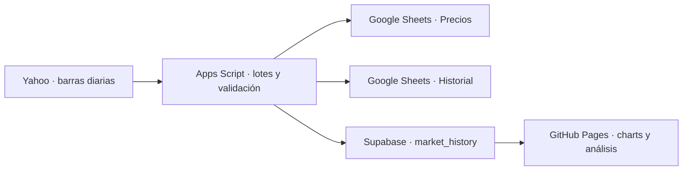

# Market Scanner — 200 empresas y 50 ETF

Aplicación estática para GitHub Pages con barras diarias de Yahoo Finance. Google Sheets conserva precios e historia; Apps Script descarga, valida y publica en Supabase; la aplicación lee cierres confirmados.



El universo tiene **250 instrumentos: 200 compañías distintas y 50 ETF**. Las empresas se seleccionan por capitalización reportada por el screener oficial de Nasdaq, incluidas extranjeras cotizadas en Estados Unidos, con una acción por compañía identificada por CIK SEC. Nasdaq fecha los precios al **14/10/2026**; descarga del **15/10/2026**. Los ETF son una selección curada de productos populares, verificados con sus emisores el 15/10/2026; no un ranking de los 50 mayores por patrimonio. Criterio y lista completa: [data/README.md](data/README.md).

Se incluyen TQQQ, QQQ, LABU, XBI, SOXX, USD, SOXL, SOXS, UPRO y QLD. El ETF estadounidense de las Magnificent Seven usa el ticker **MAGS**, según [Roundhill](https://www.roundhillinvestments.com/etf/mags/). USD corresponde a [ProShares Ultra Semiconductors](https://www.proshares.com/our-etfs/leveraged-and-inverse/usd), con objetivo diario +2×.

## Entrega

- `index.html`, `ticker.html` y `js/`: frontend adaptado a 250 instrumentos, con filtros de acciones/ETF y metadatos de exposición.
- `data/universe.json` y `.csv`: lista única para web, libro y backend.
- `apps-script/`: cuatro archivos `.gs` —uno generado— y un manifiesto, que sustituyen los scripts anteriores.
- `supabase/001_market_history.sql`: unicidad, validación, índices, permisos y marca de cierre.
- `tests/` y `tools/`: verificaciones y actualización reproducible del universo.

La plantilla Excel importable contiene dos hojas:

| Hoja | Contenido | Actualización |
| --- | --- | --- |
| `Precios` | Una fila por instrumento; OHLCV del día, cierre previo, cambio, fecha real y estado | Apps Script escribe datos y cobertura; fórmulas locales calculan cambios |
| `Historial` | Fecha, Ticker, Open, High, Low, Close, Volumen; hasta 500 sesiones por instrumento | Solo barras terminadas y validadas |

El Excel sirve como archivo y plantilla para Google Sheets. La automatización funciona en **Google Sheets con Apps Script**; Excel por sí solo no ejecuta estos scripts. Las 500 fórmulas de cambio se recalculan en ambos productos. El script mantiene el recuento de sesiones al guardar cada instrumento, evitando búsquedas repetidas sobre hasta 125.000 filas. No se mantienen fórmulas de descarga remota. Las columnas Q:U identifican tipo, categoría, emisor, apalancamiento diario e inversión; A:P conserva su estructura.

La captura inicial contiene **124.076 filas Yahoo**: conserva las 99.076 barras de las 200 empresas y añade 25.000 de los 50 ETF. Los 50 ETF tienen 500 sesiones cada uno. En total, 247 instrumentos tienen 500 sesiones; SPCX tiene 87, SKHY 69 y SNDK 420. Diez series de empresas llegan al 14/10 y están marcadas `ATRASADO`; los otros 240 instrumentos llegan al 15/10/2026. Se conserva la hora real de cada consulta. [El informe de la hoja](docs/WORKBOOK_AUDIT.md) identifica los tickers y el origen. Actualizar la captura después de importarla.

En la hoja y en la web, el multiplicador con signo identifica el objetivo **diario** de los ETF apalancados o inversos: por ejemplo +3× o −3×. Ese valor no representa la rentabilidad acumulada de varios días.

## Activar

Seguir [la guía de instalación](docs/INSTALACION.md): credenciales y respaldo, SQL, hoja y scripts, carga inicial, timers, frontend. Los archivos locales no modifican el sitio ni la base actuales por sí solos.

## Operación

El timer de `actualizarMarketScanner` actúa cada hora entre 09 y 20 ET durante días de bolsa. `Precios` puede actualizarse durante la sesión; `Historial` y Supabase reciben cierres. El día actual se confirma desde las **17:00 de Nueva York**, incluso si hubo cierre temprano. La hora del intento no reemplaza la fecha de la cotización. El fin de semana no genera filas.

La carga inicial y la reconstrucción del sábado procesan hasta 20 tickers por ejecución, descargando cinco a la vez, con continuación cada cinco minutos y límite de trabajo de 210 segundos. Una interrupción conserva el cursor. Hay hasta tres intentos; los fallos terminan como `INCOMPLETO`, con sus símbolos, y no se cuentan como éxitos. Se solicitan tres años y se eligen las últimas 500 **sesiones**, no 500 días calendario. Una IPO con menos historia se acepta solo si Yahoo confirma su primera fecha de cotización.

La actualización normal solicita un mes. Si detecta un split nuevo, precios anteriores corregidos, cobertura insuficiente o sesiones faltantes, reconstruye la serie de esa empresa antes de publicar. Cada serie completa se envía en una operación de hasta 500 filas. Primero se confirma Supabase y después la hoja; la clave `(fecha,ticker)` permite repetir sin duplicar.

La retención es **por instrumento**. El antiguo límite global ya no recorta una parte del universo. No se borran automáticamente de Supabase instrumentos que salgan de una selección futura.

## Calidad y límites

Se rechazan fechas imposibles o cerradas, identidad/moneda/zona incorrectas, valores faltantes, precios no positivos, volumen negativo/no entero y relaciones OHLC incoherentes. Se exige continuidad y el último cierre esperado. Volumen cero es válido; un dato ausente no se convierte en cero.

La columna Supabase `is_final` empieza como `false` en datos heredados. El escritor nuevo solo la marca `true` tras validar la barra; el frontend exige esa marca. Una fotografía intradía antigua no pasa a ser un cierre por haber cambiado la hora. Ejecutar el backfill antes de desplegar el frontend nuevo.

El calendario compartido cubre **2024–2030**, incluido el cierre especial del 09/01/2025. Revisar cierres extraordinarios y el horizonte cada año. La reconstrucción semanal corrige historia, pero no cambia automáticamente la selección de empresas.

Se usa el endpoint público de gráficos de Yahoo, sin contrato de disponibilidad. Puede devolver atrasos o HTTP 429; los errores se exponen y reintentan. Las cuotas y el tiempo de red de Google también se aplican; concurrencia limitada y checkpoints ayudan a trabajar dentro de ellas.

## Verificación

Desde esta carpeta, con Node.js 20+:

```powershell
node --test tests/*.test.cjs
node tools/update-universe.mjs --check
node tools/build-universe.mjs

# Renovar la selección cuando se decida hacerlo:
node tools/update-universe.mjs --refresh
node tools/build-universe.mjs

# Prueba pública de Yahoo, sin escribir en Supabase:
node tools/probe-yahoo.mjs AAPL BRK-B TSM

# Descargar solo los 50 ETF y unirlos a la captura de empresas existente:
node tools/probe-yahoo.mjs --etfs
node tools/merge-history.mjs
```

Tras cambiar el universo, regenerar también la plantilla. `prepararMarketScanner` rechaza una lista distinta para evitar escribir cotizaciones en filas equivocadas.

## Fuentes técnicas

- [Nasdaq](https://www.nasdaq.com/market-activity/stocks/screener) y [SEC, tickers y CIK](https://www.sec.gov/files/company_tickers_exchange.json).
- [Google: cuotas Apps Script](https://developers.google.com/apps-script/guides/services/quotas): seis minutos por ejecución y límites diarios.
- [Google: GOOGLEFINANCE](https://support.google.com/docs/answer/3093281/googlefinance?hl=en): los históricos de esa función no se pueden leer mediante Apps Script ni Sheets API. El nuevo flujo descarga Yahoo directamente y utiliza fórmulas locales.
- [Supabase: claves](https://supabase.com/docs/guides/getting-started/migrating-to-new-api-keys) y [upsert](https://supabase.com/docs/reference/javascript/upsert).
- [NYSE: calendario](https://www.nyse.com/trade/hours-calendars).
