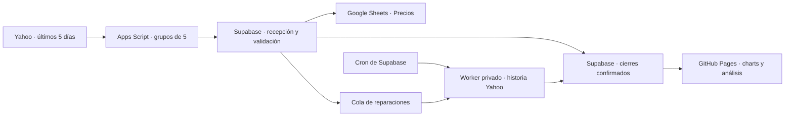

# Market Scanner — 200 empresas y 50 ETF

Aplicación estática en GitHub Pages con barras diarias de Yahoo Finance. **Supabase mantiene y valida el historial. Google Sheets descarga datos recientes y muestra el resultado del servidor.**

Estado al 16/10/2026: backend Supabase desplegado y verificado, con worker y tres trabajos Cron activos. Falta que el propietario copie esta versión del script y manifiesto, y verifique sus nuevos temporizadores de Google. Tener estos archivos no certifica que esa instalación manual ya esté hecha.



El universo contiene **250 instrumentos: 200 compañías y 50 ETF**. La selección de empresas usa capitalización del screener oficial de Nasdaq, admite compañías extranjeras cotizadas en EE. UU. y conserva una acción por compañía identificada por CIK SEC. La captura de selección es del 15/10/2026, con precios fechados por Nasdaq al 14/10. Los ETF son una selección curada verificada con sus emisores, no un ranking por patrimonio. Criterio y lista: [data/README.md](data/README.md).

Incluye TQQQ, QQQ, LABU, XBI, SOXX, USD, SOXL, SOXS, UPRO y QLD. El ETF estadounidense de las Magnificent Seven usa **MAGS**, según [Roundhill](https://www.roundhillinvestments.com/etf/mags/). [USD, de ProShares](https://www.proshares.com/our-etfs/leveraged-and-inverse/usd), tiene objetivo diario +2× sobre semiconductores. Los multiplicadores de la web identifican objetivos diarios.

## Operación

Apps Script solicita a Yahoo `range=5d`, con frecuencia diaria. Agrupa cinco tickers por petición conjunta y envía sus metadatos, timestamps y valores originales a `market_ingest_recent`. Cada ejecución procesa hasta 20 tickers con un objetivo de unos 60 segundos; una continuación de un minuto conserva el avance. Google no compara ni reconstruye series de 500 sesiones.

Supabase comprueba identidad, moneda, zona horaria, fechas de bolsa, vigencia y OHLCV. Conserva las barras intradía en almacenamiento privado. Solo los cierres confirmados alimentan `public.market_history` con `is_final=true`; este contrato conserva los charts y análisis existentes.

Si aparecen huecos, precios anteriores corregidos, splits o cobertura insuficiente, el servidor encola una reparación. El worker privado descarga la historia de ese ticker y el servidor valida y reemplaza la serie en una transacción, conservando hasta 500 sesiones reales. Cron ejecuta las auditorías, la retención y las llamadas al worker. Las IPO mantienen su historia real, aunque tenga menos de 500 sesiones.

`Precios` es la hoja de trabajo: una fila por instrumento con valores y estados devueltos por Supabase. La antigua pestaña `Historial` puede conservarse como archivo o exportación; este flujo no la lee, ordena ni actualiza. **No hace falta importar otro Excel para actualizar una hoja que ya funciona.**

La actualización horaria de Google se limita a lunes a viernes, entre 09 y 20 de Nueva York. El servidor aplica el calendario de bolsa y decide qué barras pueden confirmarse. La hora de descarga nunca sustituye a la fecha de la cotización.

## Instalar o actualizar

Seguir [INSTALACION.md](docs/INSTALACION.md): desplegar y verificar primero el backend, detener los timers anteriores y copiar el script y manifiesto nuevos con la cuenta propietaria de Google. Las propiedades privadas `SUPABASE_URL` y `SUPABASE_WRITE_KEY` siguen siendo las mismas.

La arquitectura y los límites están en [ARQUITECTURA_SUPABASE.md](docs/ARQUITECTURA_SUPABASE.md). [RENDIMIENTO_APPS_SCRIPT.md](docs/RENDIMIENTO_APPS_SCRIPT.md) explica la sustitución del procesamiento histórico en Google.

## Archivos

| Ruta | Función |
| --- | --- |
| `index.html`, `ticker.html`, `js/` | Frontend con 250 instrumentos, filtros de acciones/ETF y lectura de cierres confirmados |
| `data/universe.json`, `.csv`, `apps-script/Universe.gs` | Universo compartido y metadatos |
| `data/instrument-history-starts.json` | Fechas verificadas de inicio de las tres historias de IPO cortas |
| `apps-script/` | Descarga reciente, envío al servidor, `Precios` y temporizadores Google |
| `supabase/` | Esquema, RPC, calidad, cola, worker y programación del servidor |
| `tests/`, `tools/` | Pruebas y actualización reproducible de datos y universo |
| `docs/WORKBOOK_AUDIT.md` | Auditoría de la captura Excel anterior, conservada como registro histórico |

## Verificación

Con Node.js 22 o posterior:

```powershell
node --test tests/*.test.cjs
node tools/update-universe.mjs --check
node tools/build-universe.mjs
node tools/build-server-schema.mjs
```

La revisión pasó 47 pruebas JavaScript y 62 comprobaciones SQL en tres transacciones revertidas. Se verificaron reparaciones reales de AAPL, rechazo 401 de llamadas al worker sin token válido y la denegación de las RPC privadas a roles públicos. El historial confirmado conserva 124.076 barras de los 250 instrumentos; el respaldo privado conserva las 149.187 filas anteriores, incluidas las de tickers heredados. [Pruebas y programación](docs/ARQUITECTURA_SUPABASE.md).

La instalación y ejecución de los timers de Google requieren verificación con la cuenta del propietario. El endpoint público de Yahoo puede devolver errores o HTTP 429; los fallos se registran y reintentan sin inventar barras.

## Fuentes

- [Nasdaq](https://www.nasdaq.com/market-activity/stocks/screener) y [SEC, tickers y CIK](https://www.sec.gov/files/company_tickers_exchange.json).
- [Google: cuotas Apps Script](https://developers.google.com/apps-script/guides/services/quotas) y [activadores de tiempo](https://developers.google.com/apps-script/reference/script/clock-trigger-builder).
- [Supabase Cron](https://supabase.com/docs/guides/cron), [programar Edge Functions](https://supabase.com/docs/guides/functions/schedule-functions) y [autenticación de funciones](https://supabase.com/docs/guides/functions/auth).
