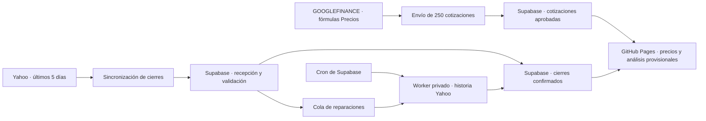

# Market Scanner — 200 empresas y 50 ETF

**Backtesting interactivo:** [abrir el módulo](backtest.html) para simular acciones, carteras y subcarteras con pesos personalizados, presets v3/SMA200 o parámetros experimentales, costes por lado y comparación con comprar y mantener. Utiliza los cierres disponibles (hasta 500 sesiones), muestra cobertura y permite exportar resultados y datos. Las carteras se guardan en el navegador. [Uso, reglas y límites](docs/BACKTESTING_MODULE.md).

**Español / English:** el selector del encabezado comparte el idioma entre el scanner, las fichas y Backtesting. Conserva filtros, parámetros y resultados al cambiar; la preferencia anterior de Backtesting se migra automáticamente. Los enlaces admiten `?lang=es` o `?lang=en`, también junto con `ticker`. Se traducen controles, explicaciones, gráficos y avisos en la presentación; los identificadores de señales y los datos de cálculo/exportación mantienen su formato original.

El ranking separa **Composite, Trend, Entry Timing y Exit Pressure**. La versión 3 exige pérdida persistente del soporte de 50 sesiones para vender, con una salida rápida ante rupturas severas con volumen. Las ventas requieren el cierre diario confirmado. Las etiquetas **Confirmed buy/sell** añaden una ruptura sostenida durante dos cierres y volumen, sin implicar mayor rentabilidad esperada; los datos atrasados quedan en Wait. [Reglas y fórmulas](docs/SCORING.md) y [evaluación histórica reservada de v3 con costes](docs/EXIT_VALIDATION.md).

**Resultado 2018–2023:** v3 obtiene +54,82%, v2 +49,60% y comprar y mantener +126,32%, con comisión $0 y deslizamiento 0,05% por lado. V3 reduce las operaciones 35,83%, pero empeora la caída máxima frente a v2 (−21,20% frente a −15,41%). No supera comprar y mantener ni acredita una ventaja consistente de las señales confirmadas. Es una prueba histórica reservada sobre el universo actual, con sesgo de supervivencia; la validación prospectiva permanece pendiente.

**Experimento SMA200, producción sin cambios:** una única variante vende después de tres cierres bajo la media de 200 sesiones. En la muestra reservada 2008–2015 obtiene +72,94%, frente a v3 +68,49% y mantener +100,93%, con comisión $0, deslizamiento 0,05% por lado y elegibilidad común de 202 barras. Reduce la caída máxima en esa muestra, pero no supera mantener, no prolonga todas las posiciones y su menor caída no se mantiene en 2025–2026. [Protocolo, comparación completa y límites de independencia](docs/LONG_TREND_VALIDATION.md).

El [primer backtest, conservado como informe histórico de v2](docs/BACKTEST.md), obtuvo +38,91% para v2 frente a +0,36% de la lógica original iniciada en efectivo y +75,60% de comprar y mantener. Sus salidas prematuras motivaron la revisión v3; ese período ya examinado no se presenta como una prueba independiente fuera de muestra.

Aplicación estática con 200 empresas y 50 ETF. **Precios recupera las fórmulas GOOGLEFINANCE y un envío rápido de 250 cotizaciones. Los gráficos y análisis incorporan la vela provisional del día, identificada como tal. Supabase valida los datos y mantiene los cierres confirmados.**

La instalación del nuevo Apps Script y sus activadores se realiza con la cuenta propietaria. Copiar esta versión y ejecutar la preparación recupera las fórmulas en el mismo libro; no exige importar de nuevo el Excel. [Ruta rápida e intradiarios](docs/COTIZACIONES_INTRADIA.md).

La corrección del 16/10 usa `BATS:ARKK`, interpreta la hora UTC de SOXS mediante una celda auxiliar y compara la antigüedad después del cierre con el horario de la sesión. Conserva la validación de identidad, horas futuras y OHLCV de Supabase. Para instalarla en Google, sustituir el script completo y ejecutar `prepararMarketScanner` una vez; las propiedades privadas se conservan.

DELL, LABU, MAGS y SPY se recuperaron mediante el worker y las respuestas Yahoo corregidas: los **250 instrumentos tienen cierre confirmado del 16/10**. Los trabajos fallidos continúan reintentándose con una hora de espera desde el quinto fallo, conservando las validaciones. [Recuperación y política de reintentos](docs/RECUPERACION_PROVEEDOR.md).

Supabase revisa los cierres de los **250 instrumentos cada día bursátil a las 20:30 de Nueva York**, desde el 19/10/2026. GitHub Actions consulta el informe desde las 20:35 y abre una incidencia asignada al propietario **solo si hay tickers pendientes, rechazados o desactualizados**. Excluye fines de semana y feriados, respeta los cambios de horario y funciona con el equipo apagado. Los fallos técnicos se registran en Actions sin abrir incidencias. [Programación, informe y avisos](docs/REVISION_CIERRE_CLOUD.md).



El universo contiene **250 instrumentos: 200 compañías y 50 ETF**. La selección de empresas usa capitalización del screener oficial de Nasdaq, admite compañías extranjeras cotizadas en EE. UU. y conserva una acción por compañía identificada por CIK SEC. La captura de selección es del 15/10/2026, con precios fechados por Nasdaq al 14/10. Los ETF son una selección curada verificada con sus emisores, no un ranking por patrimonio. Criterio y lista: [data/README.md](data/README.md).

Incluye TQQQ, QQQ, LABU, XBI, SOXX, USD, SOXL, SOXS, UPRO y QLD. El ETF estadounidense de las Magnificent Seven usa **MAGS**, según [Roundhill](https://www.roundhillinvestments.com/etf/mags/). [USD, de ProShares](https://www.proshares.com/our-etfs/leveraged-and-inverse/usd), tiene objetivo diario +2× sobre semiconductores. Los multiplicadores de la web identifican objetivos diarios.

## Operación

`actualizarCotizacionesAhora` lee de una vez las 250 filas calculadas y las envía en una solicitud a `market_ingest_sheet_quotes`. Esta ruta no espera a las continuaciones de Yahoo. Con los activadores instalados se repite cada cinco minutos. La aplicación puede refrescar su cotización sin descargar de nuevo todo el historial cuando sigue vigente.

Supabase comprueba identidad, fechas, antigüedad y OHLCV. `public.market_latest_quotes` expone solo las cotizaciones aprobadas; las tablas y eventos de control siguen privados. La web combina esas cotizaciones con `public.market_history`. Una vela provisional puede cambiar el precio y los indicadores, y nunca sustituye un cierre confirmado de su misma fecha.

`actualizarMarketScanner` conserva Yahoo `range=5d` para sincronizar los cierres en segundo plano: grupos de cinco y hasta 20 tickers por ejecución, con continuación por minuto. La captura Google Finance no se convierte en cierre del historial; esa confirmación sigue bajo las reglas Yahoo del servidor.

Si aparecen huecos, precios anteriores corregidos, splits o cobertura insuficiente, el servidor encola una reparación. El worker privado descarga la historia de ese ticker y el servidor valida y reemplaza la serie en una transacción, conservando hasta 500 sesiones reales. Cron ejecuta las auditorías, la retención y las llamadas al worker. Las IPO mantienen su historia real, aunque tenga menos de 500 sesiones.

`Precios` tiene una fila por instrumento. C:I y V contienen fórmulas nativas; L:M muestran el envío y su estado; N, el recuento de cierres; W:X, el mantenimiento histórico. La pestaña `Historial` queda como archivo. **No hace falta importar otro Excel.** La hora de cotización viene de `tradetime`, no de `NOW()`.

Las ejecuciones programadas de Google se limitan a lunes a viernes entre las horas 09 y 20 de Nueva York. Las llamadas manuales permiten solicitar un envío fuera de esa ventana. Google Finance puede retrasar sus precios hasta 20 minutos o no ofrecer atributos de ciertos símbolos; el envío rápido utiliza los datos disponibles y no fuerza al proveedor a renovarlos.

## Instalar o actualizar

Seguir [INSTALACION.md](docs/INSTALACION.md): desplegar y verificar primero el backend, detener los timers anteriores y copiar el script y manifiesto nuevos con la cuenta propietaria de Google. Las propiedades privadas `SUPABASE_URL` y `SUPABASE_WRITE_KEY` siguen siendo las mismas.

La arquitectura y los límites están en [ARQUITECTURA_SUPABASE.md](docs/ARQUITECTURA_SUPABASE.md). [RENDIMIENTO_APPS_SCRIPT.md](docs/RENDIMIENTO_APPS_SCRIPT.md) explica la sustitución del procesamiento histórico en Google.

## Archivos

| Ruta | Función |
| --- | --- |
| `index.html`, `ticker.html`, `js/` | Frontend con 250 instrumentos, análisis provisional identificado y modo de cierres |
| `data/universe.json`, `.csv`, `apps-script/Universe.gs` | Universo compartido y metadatos |
| `data/instrument-history-starts.json` | Fechas verificadas de inicio de las tres historias de IPO cortas |
| `apps-script/` | Descarga reciente, envío al servidor, `Precios` y temporizadores Google |
| `supabase/` | Esquema, RPC, calidad, cola, worker y programación del servidor |
| `tests/`, `tools/` | Pruebas y actualización reproducible de datos y universo |
| `docs/WORKBOOK_AUDIT.md` | Auditoría de la captura Excel anterior, conservada como registro histórico |

## Verificación

Con Node.js 22 o posterior:

```powershell
node --test tests/*.test.cjs tests/*.test.mjs
node tools/update-universe.mjs --check
node tools/build-universe.mjs
node tools/build-server-schema.mjs
```

La verificación distingue pruebas de Apps Script, frontend, worker y regresiones SQL revertidas. [VERIFICACION.md](docs/VERIFICACION.md) registra la evidencia y el alcance de la instalación. El conjunto inicial tiene 124.076 barras confirmadas para los 250 instrumentos, y mantiene las historias reales cortas de las IPO.

La instalación y ejecución de los timers de Google requieren verificación con la cuenta del propietario. El endpoint público de Yahoo puede devolver errores o HTTP 429; los fallos se registran y reintentan sin inventar barras.

## Fuentes

- [Nasdaq](https://www.nasdaq.com/market-activity/stocks/screener) y [SEC, tickers y CIK](https://www.sec.gov/files/company_tickers_exchange.json).
- [Google: cuotas Apps Script](https://developers.google.com/apps-script/guides/services/quotas) y [activadores de tiempo](https://developers.google.com/apps-script/reference/script/clock-trigger-builder).
- [Google: GOOGLEFINANCE, atributos y retrasos](https://support.google.com/docs/answer/3093281?hl=es).
- [Supabase Cron](https://supabase.com/docs/guides/cron), [programar Edge Functions](https://supabase.com/docs/guides/functions/schedule-functions) y [autenticación de funciones](https://supabase.com/docs/guides/functions/auth).
