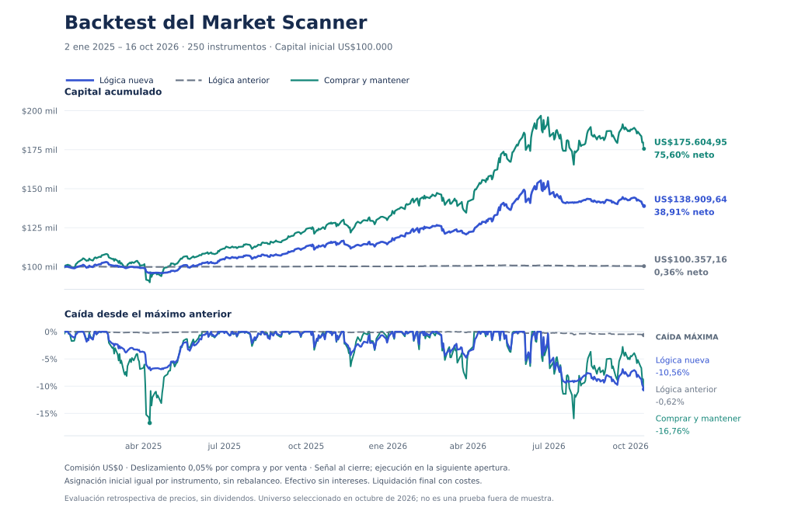

# Backtest comparativo: lógica anterior y Entry/Exit v2

**La nueva lógica supera a la anterior cuando ambas empiezan en efectivo, pero no demuestra una mejora del timing frente a comprar y mantener.** En esta captura obtiene **+38,91% neto**, frente a **+0,36%** de la anterior y **+75,60%** de comprar y mantener los mismos instrumentos. Reduce la caída máxima frente a mantener, a cambio de una exposición menor. Las señales de venta, incluidas las fuertes, no aportan una ventaja media a 5, 10 ni 20 sesiones.

El resultado justifica corregir el exceso de Hold, pero **no permite presentar Buy/Sell ni Strong Buy/Strong Sell como señales de rentabilidad validada**. Los umbrales de producción no se han recalibrado con estos resultados.

## Diseño y datos

Captura del 19/10/2026 a las 21:09 de Nueva York (`2026-10-20T01:09:15.427Z`): **124.082 barras confirmadas**, 250 instrumentos, desde el 18/10/2024. No hay filas inválidas, duplicadas ni provisionales en esta captura. Hay 200 acciones, 40 ETF con exposición diaria 1× y 10 ETF apalancados o inversos.

La comparación principal cubre **02/01/2025–16/10/2026: 449 sesiones**. El 16/10 es el último cierre común: seis instrumentos aún no tenían el cierre del 19/10. El calendario bursátil se comprueba de forma explícita; no hubo operaciones ejecutadas con señales de sesiones ausentes, valoraciones atrasadas ni liquidaciones con precios faltantes.

- Capital inicial ilustrativo: **$100.000**, distribuido en 250 cuentas independientes de **$400**. Se admiten fracciones de acciones; no se reasigna efectivo entre instrumentos ni se rebalancea. Esto prueba las señales de cada instrumento, **no una cartera que compra los primeros N del ranking**.
- Ambas estrategias empiezan en efectivo. Buy o Strong Buy invierte todo el saldo de su cuenta; Sell o Strong Sell vende toda la posición. Hold y Wait conservan la posición existente. No hay ventas en corto ni apalancamiento adicional; los ETF mantienen su exposición incorporada.
- Cada señal usa únicamente barras hasta su cierre, con un máximo de 500 y un mínimo de 50. Se ejecuta a la **apertura de la siguiente sesión**, nunca al cierre que produjo la señal. Se usa exactamente el motor de producción v2 y una copia congelada de la lógica anterior, incluidos sus defectos y pesos por defecto; no se sustituyen por aproximaciones de indicadores.
- Comprar y mantener usa las mismas fechas de elegibilidad y costes. SNDK puede entrar desde el 28/04/2025, SPCX desde el 25/08/2026 y SKHY desde el 21/09/2026; sus cuentas esperan en efectivo antes. No se inventa historia anterior a estos listados.
- Comisión del bróker indicada por el usuario: **$0**. Deslizamiento principal: **5 puntos básicos (0,05%) por cada compra y cada venta**. Es un supuesto de ejecución adversa frente a la apertura, no una comisión ni una medición del spread real.
- Todas las posiciones se liquidan al cierre del 16/10, con costes, por una regla común de fin del experimento. La señal del propio cierre final no puede ejecutar una orden ese día.
- Se usan precios OHLC almacenados del proveedor: **rentabilidad de precio, sin dividendos**, intereses sobre efectivo, impuestos ni cargos regulatorios. Los gastos internos de los ETF ya están reflejados en sus precios.

La captura usa `quote` OHLC de Yahoo, no `adjclose`. La revisión parcial del historial de LABU es consistente con el ajuste de su split inverso de diciembre de 2023; no equivale a una auditoría exhaustiva de todos los splits, escisiones y revisiones. El experimento reconstruye señales sobre los datos capturados, no sobre versiones de datos archivadas en cada fecha histórica.

## Resultados principales, después de costes

| Métrica | Anterior | Nueva v2 | Comprar y mantener |
| --- | ---: | ---: | ---: |
| Capital final | $100.357,16 | $138.909,64 | $175.604,95 |
| Rentabilidad acumulada | +0,36% | **+38,91%** | **+75,60%** |
| Rentabilidad anualizada | +0,20% | +20,21% | +37,08% |
| Caída máxima desde un máximo previo | −0,62% | **−10,56%** | −16,76% |
| Volatilidad anualizada | 0,49% | 13,23% | 21,34% |
| Sharpe, tasa libre de riesgo 0 | 0,41 | 1,46 | 1,59 |
| Exposición media por valor de mercado | 0,68% | 62,33% | 99,34% |
| Operaciones completas, compra y venta | 1 | 2.247 | 250 |
| Salidas por señal | 0 | 2.128 | 0 |
| Salidas por fin del experimento | 1 | 119 | 250 |
| Porcentaje de operaciones ganadoras | 100%* | 36,40% | 82,80% |
| Factor de beneficio | No definido* | 2,20 | 22,88 |
| Comisiones cobradas | $0 | $0 | $0 |
| Deslizamiento acumulado en ejecuciones | $0,58 | $1.009,87 | $137,82 |

\* La anterior sólo compró VRT, el 29/01/2025, tras la señal del 28/01. Su 100% de acierto representa una sola operación y no tiene valor estadístico. No tuvo pérdidas realizadas, por lo que el factor de beneficio no se expresa como un número finito. Las estadísticas de operaciones incluyen las liquidaciones finales, identificadas por separado.

La pérdida de capital final frente al escenario sin costes no tiene por qué coincidir con la suma de costes de las ejecuciones: pagar costes también modifica el capital disponible para rendimientos posteriores. La caída máxima se calcula sobre los cierres diarios de la cartera, no sobre mínimos intradiarios. El Sharpe usa retornos diarios, desviación muestral y 252 sesiones anuales; no descuenta un rendimiento monetario alternativo.

La nueva lógica gana a la anterior en **161/250 instrumentos**, pero a comprar y mantener sólo en **45/250**. La diferencia mediana por instrumento es +12,35 puntos porcentuales frente a la anterior y −19,97 frente a mantener.



## El punto de partida cambia la interpretación

La anterior casi nunca compra ni vende. Compararla desde efectivo equivale en gran medida a compararla contra efectivo sin intereses. Para comprobarlo se fuerza una compra inicial en cada instrumento al ser elegible y luego se obedecen las señales:

| Inicio con compra forzada | Anterior | Nueva | Comprar y mantener |
| --- | ---: | ---: | ---: |
| Rentabilidad neta | +75,60% | +43,96% | +75,60% |
| Caída máxima | −16,76% | −11,68% | −16,76% |

Este escenario es una compra inicial nueva con costes, no una simulación de una cartera heredada. La anterior coincide con mantener porque no genera ventas. Por tanto, **superar al sistema anterior desde efectivo no demuestra que las nuevas entradas y salidas elijan mejor el momento**.

## Frecuencia de señales y resultados posteriores

En las 111.482 observaciones instrumento/día existentes dentro del período:

| Señal | Anterior | Nueva |
| --- | ---: | ---: |
| Strong Buy | 0 | 1.878 |
| Buy | 1 | 17.783 |
| Hold | 111.334 | 77.952 |
| Sell | 0 | 9.929 |
| Strong Sell | 0 | 3.793 |
| Wait, calentamiento de listados recientes | 147 | 147 |

Excluido Wait, Hold pasa del **99,999% al 70,02%**. Contar días de señal no equivale a contar operaciones: una posición no vuelve a comprarse porque aparezca otro Buy.

Se analiza además el inicio de cada familia de señales. Para cada instrumento, dirección y horizonte se descartan ventanas solapadas. Una señal ya activa al inicio de la comparación puede generar el primer evento; una aparición de Strong se estudia también aunque hubiese un Buy/Sell normal previo. La entrada y la salida se miden en aperturas, desde la siguiente apertura hasta 5, 10 o 20 sesiones después, siempre dentro del período.

| Familia nueva | Horizonte | Eventos | Resultado medio neto | Resultado positivo |
| --- | ---: | ---: | ---: | ---: |
| Buy, incluye fuertes | 5 sesiones | 7.434 | +0,29% | 52,21% |
| Buy, incluye fuertes | 10 sesiones | 5.187 | +0,83% | 54,75% |
| Buy, incluye fuertes | 20 sesiones | 3.336 | +1,86% | 57,37% |
| Strong Buy | 5 sesiones | 1.397 | +0,30% | 53,26% |
| Strong Buy | 10 sesiones | 1.291 | +0,98% | 53,52% |
| Strong Buy | 20 sesiones | 1.144 | +1,81% | 57,60% |
| Sell, incluye fuertes | 5 sesiones | 5.370 | **−0,54%** | 45,51% |
| Sell, incluye fuertes | 10 sesiones | 3.836 | **−1,15%** | 43,35% |
| Sell, incluye fuertes | 20 sesiones | 2.558 | **−2,16%** | 43,51% |
| Strong Sell | 5 sesiones | 2.108 | **−1,19%** | 43,50% |
| Strong Sell | 10 sesiones | 1.802 | **−1,83%** | 41,01% |
| Strong Sell | 20 sesiones | 1.453 | **−3,53%** | 37,44% |

Para Buy, el resultado es la rentabilidad de comprar y vender al horizonte, neta de ambas ejecuciones. Para Sell es la **ventaja de vender, permanecer en efectivo y recomprar**, frente a mantener la posición, expresada sobre el valor inicial de ésta. Un resultado negativo significa que mantener habría sido mejor; **no representa la rentabilidad de una venta en corto**.

Con `s = deslizamiento` y `c = comisión`, el factor de ida y vuelta es `F = (1−s)(1−c)/((1+s)(1+c))`. Si `R = apertura_final/apertura_inicial`, Buy devuelve `R×F−1` y la ventaja Sell devuelve `F−R`. Son medidas diferentes porque una sigue una inversión nueva y la otra compara una salida y recompra con una posición ya existente.

Los eventos se correlacionan entre instrumentos, las categorías fuertes se solapan con las generales y los horizontes también se solapan entre sí. Son estadísticas descriptivas, no miles de observaciones independientes. El único Buy anterior tuvo +4,79%, +1,86% y −4,91% a 5/10/20 sesiones; no existe una muestra anterior suficiente para comparar precisión. Que los Buy nuevos tengan retorno positivo tampoco demuestra ventaja sobre la tendencia general del mercado. **Strong no presenta una superioridad consistente.**

## Sensibilidad a los costes

La comisión real del usuario permanece en $0 en las cuatro primeras filas. Los costes son por lado.

| Comisión / deslizamiento | Anterior | Nueva | Comprar y mantener |
| --- | ---: | ---: | ---: |
| 0 / 0 pb | +0,36% | +40,07% | +75,78% |
| 0 / 5 pb, principal | +0,36% | +38,91% | +75,60% |
| 0 / 10 pb | +0,36% | +37,76% | +75,43% |
| 0 / 25 pb | +0,35% | +34,39% | +74,90% |
| 5 / 5 pb, estrés hipotético | +0,36% | +37,76% | +75,43% |

La nueva lógica sigue superando a la anterior desde efectivo bajo estos supuestos, pero queda por debajo de mantener incluso sin ningún coste. La diferencia no se explica sólo por comisiones o deslizamiento.

## Períodos, grupos y concentración

| Escenario | Anterior | Nueva | Comprar y mantener |
| --- | ---: | ---: | ---: |
| 200 acciones | +0,45% | +43,67% | +85,67% |
| 40 ETF 1× | 0,00% | +15,80% | +32,12% |
| 10 ETF apalancados/inversos | 0,00% | +36,09% | +48,24% |
| SPY individual | 0,00% | +21,46% | +29,37% |
| Sólo 2025 | +0,19% | +14,32% | +29,83% |
| Sólo 2026 hasta 16/10 | 0,00% | +12,95% | +23,99% |
| 200 barras previas, desde 11/08/2025 | 0,00% | +22,77% | +42,56% |
| Sin MRNA | +0,36% | +38,33% | +74,24% |
| Sin SNDK | +0,36% | +30,05% | +60,33% |
| Sin los cinco mayores contribuyentes nuevos* | +0,36% | +23,24% | +51,40% |

Los escenarios anuales **reinician en efectivo** y conservan la historia previa para calcular indicadores. No son las contribuciones de cada año a la cartera principal ni pruebas fuera de muestra. En la sensibilidad de 200 barras, SPCX y SKHY permanecen en efectivo; SNDK se vuelve elegible el 01/12/2025. Cada grupo mantiene $100.000 de capital inicial, repartido igualmente entre sus miembros.

\* SNDK, WDC, MU, SOXL y STX se seleccionan **después de observar sus resultados**, sólo para revelar concentración, no como una regla invertible de exclusión. Sus rendimientos extremos hacen necesario leer el agregado con cuidado. SNDK aporta aproximadamente 8,98 puntos porcentuales del +38,91%; los cinco juntos, 16,14 puntos. Las conclusiones frente a mantener persisten al excluirlos.

La captura también contiene un salto de MRNA de aproximadamente +177% de cierre a cierre el 19/08/2026. No se ha eliminado para mejorar el resultado ni se afirma que sea un error; se publica la sensibilidad sin ese instrumento. La ausencia de anomalías OHLC formales no certifica cada evento corporativo.

En **VLO**, la nueva lógica obtiene +105,42% con 9 operaciones, frente a +260,31% de mantener y 0% de la anterior desde efectivo. Su caída máxima individual con la nueva lógica fue −28,26%. Distinguir tendencia y entrada sigue siendo conceptualmente útil, pero este historial no demuestra que las entradas y salidas de VLO hayan aumentado la rentabilidad.

Un bootstrap exploratorio de bloques circulares de 20 sesiones, con 2.000 réplicas y semilla fija, compara las diferencias diarias de las carteras completas. El intervalo del 95% para la diferencia **media diaria** nueva−anterior es [+0,0019%; +0,1494%]; para nueva−mantener, [−0,1087%; −0,0101%]. No son intervalos para la rentabilidad acumulada, no corrigen sesgos de selección y no prueban rendimientos futuros.

## Límites y decisión

El universo es la selección actual de octubre de 2026, aplicada retrospectivamente. Faltan componentes históricos y empresas excluidas o desaparecidas: hay sesgo de supervivencia y de selección. La historia disponible es corta y contiene grandes ganadores. Las reglas se diseñaron después de que existieran estos datos; calcular causalmente los indicadores evita usar barras futuras en cada señal, pero **no convierte el experimento en una validación fuera de muestra**.

Las ejecuciones son hipotéticas, sin simulación de capacidad, liquidez o spread real. No se incluyen dividendos ni rendimiento del efectivo. No se han buscado parámetros para maximizar este backtest. Como explica [Investor.gov sobre resultados de inversión](https://www.investor.gov/introduction-investing/general-resources/news-alerts/alerts-bulletins/investor-bulletins-47), los resultados hipotéticos deben distinguirse de un historial real.

**Decisión:** conservar la separación conceptual entre tendencia, entrada y presión de salida, pero tratar sus etiquetas como reglas técnicas pendientes de validación económica. Esta prueba encuentra más actividad y menor caída máxima frente a mantener, **sin demostrar una mejora general del timing**. Las ventas son el principal punto a investigar en una siguiente versión con reglas fijadas antes de evaluarlas sobre datos realmente no usados. No se modifica producción para perseguir este resultado histórico.

## Reproducibilidad y archivos

Motor evaluado: v2.0.0, publicado en el commit `dee9679ea78716f49984c97f8e2c2aa0a0ec41dd`. Los hashes del motor, baseline, panel, ejecución, universo y calendario se conservan en el resumen. SHA-256 del archivo de captura original:

```text
aa7b82d79068ea400ee1c352019431a57347c9419e6a6acd5be09ce8d37160bb
```

El archivo de entrada local es `outputs/scoring-review/current-history.json` en el espacio de trabajo. Su contenido OHLC completo y la caché de señales no se duplican en GitHub; para reproducir exactamente estos números se necesita esa misma captura. Repetir con una descarga posterior puede cambiar datos y resultados.

Desde la raíz del código, con Node.js 22 o posterior:

```sh
node tools/backtest.mjs --input /ruta/current-history.json --output /ruta/backtest --commission-bps 0 --slippage-bps 5
node --test tests/*.test.cjs tests/*.test.mjs
python tools/plot-backtest.py --input /ruta/backtest/results.json --output /ruta/backtest/backtest.png
```

El gráfico requiere `matplotlib`; el backtest y sus pruebas usan sólo Node. La primera ejecución calcula cada prefijo histórico; las siguientes reutilizan la caché únicamente si coinciden archivo de entrada, código de señales y parámetros. Se rechaza una caché incompatible y se protege la entrada contra sobrescrituras.

Se generan `results.json`, `signal-panel.json`, `trades.csv`, `executions.csv`, `equity.csv`, `per-ticker.csv`, `scenarios.csv` y `events.csv`. Los libros de operaciones distinguen señal, fecha, apertura de referencia, ejecución con costes y motivo de salida. Los archivos completos están en `outputs/backtest` del espacio de trabajo.

En el repositorio quedan el [resumen con hashes y escenarios](../data/backtests/2026-10-19-summary.json), la [comparación de los 250 instrumentos](../data/backtests/2026-10-19-per-ticker.csv) y las [curvas diarias compactas](../data/backtests/2026-10-19-equity.csv). La validación local completa pasó **189 pruebas**, incluyendo causalidad de señales, ejecución posterior, costes en ambas direcciones, ventanas de eventos y entradas inválidas. GitHub Actions ejecuta el mismo conjunto sin consultar datos de mercado.
