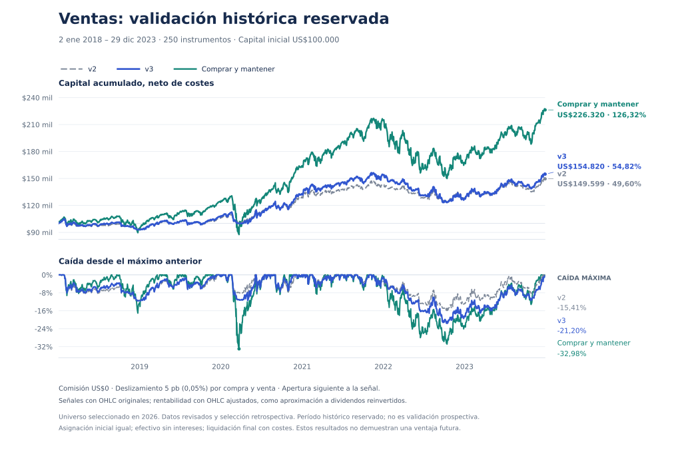

# Ventas v3: tendencias, confirmación y prueba histórica reservada

## Qué cambia

La versión 3 conserva las compras ordinarias de v2 y la separación entre Trend, Entry y Composite. Cambia las ventas para priorizar tendencias de varias semanas, conforme a la preferencia del usuario:

- **Salida persistente:** tres cierres consecutivos por debajo de la SMA50 de cada fecha, SMA50 actual no superior a la de cinco sesiones antes y cierre a más de un ATR bajo la SMA50. Un retroceso del momentum por sí solo ya no basta.
- **Salida rápida por ruptura severa:** cierre inferior al mínimo de las veinte sesiones anteriores menos un ATR previo, inferior a la SMA50 menos dos ATR previos, caída diaria y volumen relativo de al menos 1,5. El ATR previo evita que el propio salto infle su umbral de detección.
- Ambas salidas requieren una vela diaria finalizada. La salida estructural tiene prioridad sobre una compra en caso de conflicto. Los indicadores no conocen la posición ni garantizan un precio de ejecución.
- Las categorías antes llamadas Strong se muestran como **Confirmed buy / Confirmed sell**. Exigen que una ruptura mantenga el mismo nivel durante dos cierres y volumen relativo mínimo de 1,5 en el actual y 1,2 en el previo. La compra confirmada conserva además los filtros de entrada fuerte de v2; la venta confirmada requiere la salida persistente. Una ruptura severa de un solo día no basta para esa etiqueta.

“Confirmed” describe evidencia técnica adicional, **no una mayor probabilidad de ganar ni una ventaja económica validada**. [Fórmulas completas](SCORING.md). Las reglas fueron fijadas una sola vez; no se buscaron parámetros por rentabilidad.

## Qué significa aquí fuera de muestra

El estudio anterior examinó 2025–2026 y sus resultados motivaron este cambio. **Ese período ya no puede usarse como prueba independiente fuera de muestra.** Para aportar evidencia nueva se descargó historia no utilizada anteriormente y se fijó un período reservado de **02/01/2018–29/12/2023**, con 2016–2017 para preparar los indicadores.

Es un **holdout histórico bloqueado antes de calcular sus resultados**, pero **no una prueba prospectiva ni una validación cronológica independiente**: el diseño aprovecha observaciones de años posteriores. El universo de octubre de 2026 aplicado a 2018 también introduce selección retrospectiva y supervivencia. Estas restricciones impiden afirmar una validación fuera de muestra completa, incluso si los números resultan favorables. La separación de datos por sí sola no elimina el sobreajuste en inversión ([Bailey y colaboradores](https://www.davidhbailey.com/dhbpapers/backtest-prob.pdf)).

El [protocolo fijado](../data/validation/exit-v3-protocol.json) contiene una candidata, fechas, reglas, costes, comparadores, subperíodos y criterio de éxito. Las reglas y el [primer registro de hashes](../data/validation/exit-v3-freeze-adjusted-features.json) se guardaron el `2026-10-20T01:56:38.946Z` —19 de octubre, 21:56 en Nueva York— antes de calcular rentabilidades. La candidata y el protocolo quedaron registrados en el [commit de congelación](https://github.com/jpmauricio2906-bot/market-scanner/commit/93e07f20c10d398c017218681fde29dcdda0df1b).

Antes de inspeccionar ninguna métrica se detectó y corrigió una diferencia de datos de entrada: producción calcula señales con OHLC originales, no con OHLC ajustados por dividendos. Las reglas quedaron intactas; las señales originales se alinearon exactamente con las barras ajustadas usadas sólo para rentabilidad. El cálculo previo se conserva sin usarse para elegir parámetros. El [registro de la evaluación corregida](../data/validation/exit-v3-freeze.json) es de `2026-10-20T02:05:19.283Z`, y la corrección quedó en [su propio commit](https://github.com/jpmauricio2906-bot/market-scanner/commit/8821fda79716471788caff86d2092f78a2e82159) antes de inspeccionar resultados.

La validación prospectiva queda definida desde la ejecución del **20/10/2026**, con un mínimo de 126 sesiones futuras. Su estado es pendiente: hoy no existen esos resultados. Cambiar las reglas reiniciaría esa validación.

## Datos y ejecución

Se descargaron **474.950 barras válidas de 2016–2023**, correspondientes a 246 de los 250 instrumentos actuales. GEV, SKHY, SNDK y SPCX todavía no cotizaban; sus cuatro asignaciones permanecen en efectivo. No se redistribuye ese capital ni se inventan precios. Se verificaron las fechas de inicio del proveedor y no hubo fallos de descarga omitidos.

El período de evaluación tiene **1.509 sesiones**. Se contrastó el calendario bursátil completo con SPY, incluyendo el cierre extraordinario del 05/12/2018 y Juneteenth desde 2022 ([NYSE, cierre de 2018](https://ir.theice.com/press/news-details/2018/New-York-Stock-Exchange-to-Honor-President-George-H-W-Bush/default.aspx), [calendario NYSE 2022](https://www.nyse.com/publicdocs/ICE_NYSE_2022_Yearly_Trading_Calendar.pdf)). Dos barras de SHEL, del 05/05/2021 y del 24/01/2023, tenían OHLC inválidos y se excluyeron, sin rellenarlas. Se corrigieron únicamente errores de redondeo de coma flotante en 230 envolventes OHLC ajustadas. Las respuestas originales permanecen disponibles para auditoría.

Las señales se calculan con **OHLC originales, igual que producción**. Para medir su rentabilidad, la comparación principal utiliza **OHLC multiplicados por `adjclose/close` de Yahoo**, como aproximación del rendimiento total con reinversión de distribuciones. Es una serie sintética ajustada del proveedor: **no son precios históricos ejecutables literales**, ni una contabilidad exacta del pago de dividendos. La sensibilidad sin dividendos usa las mismas señales y los OHLC originales también para ejecutar y valorar. Las revisiones, acciones corporativas y metodología del proveedor no se auditan de forma exhaustiva; no se modelan impuestos ni fechas efectivas de reinversión.

Capital ilustrativo: $100.000, repartido inicialmente en 250 asignaciones independientes de $400. Fracciones de acciones, sin rebalanceo, ventas en corto, intereses sobre efectivo ni apalancamiento adicional. Los ETF apalancados e inversos conservan sus riesgos incorporados.

La comisión del usuario es **$0** y el deslizamiento principal es **0,05% por compra y por venta**. Se prueba también 0%, 0,10% y 0,25%. Los cargos regulatorios, spreads medidos, liquidez y capacidad no están modelados. La señal usa sólo sus últimas 500 barras disponibles, exige al menos 50 y ejecuta en la apertura de la siguiente sesión contigua. Hold/Wait conserva la posición. La venta por persistencia exige al menos 55 barras; la ruta rápida puede funcionar desde 50. Toda posición abierta se liquida al cierre final preestablecido, con costes.

Se comparan v2 congelada, v3, comprar y mantener desde la primera apertura elegible y una ablación que **compra con v2 pero no vende por señales**. Esta última separa el coste de las salidas del coste de esperar una entrada. Los subperíodos 2018–2020 y 2021–2023 reinician el efectivo; no son contribuciones anuales de la cartera principal. Una prueba adicional fuerza la compra inicial y después aplica cada lógica.

## Resultado: menos rotación, sin superar comprar y mantener

**La candidata no cumple el criterio de éxito económico fijado.** Mejora la rentabilidad acumulada frente a v2 en 5,22 puntos porcentuales, pero queda 71,50 puntos por debajo de comprar y mantener. La menor caída que comprar y mantener no cambia ese resultado. Frente a v2, la caída máxima empeora y el Sharpe baja.

| 2018–2023, neto de costes | v2 anterior | v3 tendencias | Comprar y mantener | Compras v2 sin ventas por señal |
| --- | ---: | ---: | ---: | ---: |
| Rentabilidad acumulada | 49,60% | 54,82% | 126,32% | 122,32% |
| Rentabilidad anualizada | 6,96% | 7,57% | 14,62% | 14,27% |
| Caída máxima | −15,41% | −21,20% | −32,98% | −32,93% |
| Sharpe, referencia efectivo 0% | 0,719 | 0,682 | 0,744 | 0,735 |
| Exposición media | 55,93% | 65,90% | 96,28% | 95,66% |
| Operaciones cerradas, incluido cierre final | 7.206 | 4.624 | 246 | 246 |
| Salidas por señal | 6.992 | 4.399 | 0 | 0 |
| Permanencia mediana, sesiones | 19 | 35 | — | — |
| Deslizamiento imputado sobre $100.000 | $3.363,96 | $2.146,33 | $161,59 | $159,59 |

La comisión es $0 en todos los casos. Los costes se aplican a cada ejecución; su importe acumulado no equivale a restar esa cantidad al resultado sin costes, porque también cambia el capital disponible para operaciones posteriores. Una operación cerrada es un ciclo de compra y venta, no una única orden.



La v3 reduce un **35,83%** los ciclos de compra/venta y un **37,09%** las salidas por señal. La permanencia mediana pasa de 19 a 35 sesiones. Esto confirma el cambio solicitado de comportamiento, pero no demuestra que vender sea más rentable que mantener. De hecho, conservar las compras de v2 y eliminar sus ventas obtiene 122,32%: gran parte de la diferencia está asociada a las salidas y a la exposición posterior, no sólo al momento inicial de compra.

### Costes, subperíodos y grupos

| Deslizamiento por cada lado; comisión $0 | v2 | v3 | Comprar y mantener |
| --- | ---: | ---: | ---: |
| 0,00% | 53,85% | 57,57% | 126,55% |
| 0,05%, escenario principal | 49,60% | 54,82% | 126,32% |
| 0,10% | 45,47% | 52,12% | 126,10% |
| 0,25% | 33,77% | 44,33% | 125,42% |

| Escenario, comisión $0 y deslizamiento 0,05% | v2 | v3 | Comprar y mantener |
| --- | ---: | ---: | ---: |
| 2018–2020, efectivo reiniciado | 29,57% | 33,03% | 64,12% |
| 2021–2023, efectivo reiniciado | 13,88% | 15,37% | 41,02% |
| Sólo acciones | 51,87% | 60,07% | 139,19% |
| ETF sin apalancamiento | 31,55% | 27,64% | 62,75% |
| ETF apalancados/inversos | 76,31% | 58,46% | 123,15% |
| Sólo SPY | 51,91% | 58,73% | 96,03% |
| Compra inicial forzada, luego reglas | 52,23% | 57,52% | 126,32% |
| Precios originales, sin dividendos | 40,70% | 43,78% | 105,23% |

La v3 no supera comprar y mantener en ninguno de estos escenarios. Tampoco mejora uniformemente a v2: empeora en ambos grupos de ETF. Por instrumento, gana a v2 en 133 de los 246 con historia y a comprar y mantener en sólo 42. La mediana de la diferencia frente a comprar y mantener es −47,00 puntos porcentuales. VLO, que motivó la discusión inicial, sí mejora en este período (v3 143,64%, v2 77,14%, mantener 82,64%), pero ese caso particular no representa al conjunto.

El período ya conocido **2025–2026**, que no cuenta como fuera de muestra, da v3 42,23%, v2 38,91% y mantener 75,60%, con caída máxima v3 −14,66% frente a v2 −10,56%. Se incluye como diagnóstico, no como confirmación independiente.

### ¿Las ventas y las etiquetas confirmadas ayudan?

| Ventaja media neta de vender y recomprar frente a mantener | 5 sesiones | 10 sesiones | 20 sesiones |
| --- | ---: | ---: | ---: |
| Todas las ventas v2 | −0,505% | −0,849% | −1,554% |
| Todas las ventas v3 | −0,357% | −0,460% | −1,271% |
| Ventas confirmadas v3 | +0,195% | +0,410% | −0,675% |

Las ventas de v3 tienen una desventaja media menor que las de v2, pero el promedio del conjunto sigue favoreciendo mantener a los tres horizontes. Las ventas confirmadas tienen una media positiva a 5 y 10 sesiones, **pero medianas negativas y sólo aproximadamente un 45% de eventos favorables**. A 20 sesiones también es negativa su media. Los recuentos confirmados son 1.793, 1.669 y 1.545, respectivamente, en 245 instrumentos; no se han establecido ventajas estadísticamente fiables de esa etiqueta.

Las compras confirmadas obtienen +0,396%, +0,424% y +0,724% netos a 5, 10 y 20 sesiones, con 507, 495 y 489 eventos en 206 instrumentos. Las ordinarias obtienen +0,114%, +0,467% y +0,901%. La etiqueta confirmada **no domina a la ordinaria a todos los horizontes**, por lo que no se presenta como una compra de mayor rentabilidad esperada. Las muestras pertenecen a fechas distintas y no constituyen un experimento aleatorizado.

Las etiquetas confirmadas se vuelven menos frecuentes: 539 días-instrumento de compra y 2.623 de venta, frente a 5.866 y 14.077 en v2. Hold pasa de 250.991 a 207.367 días-instrumento dentro de las 360.633 observaciones disponibles del período; no se han bajado umbrales para fabricar una cuota de señales fuertes. Una etiqueta de venta persistente puede durar varios días aunque la posición ya se haya vendido, por lo que la cantidad de días SELL no mide la rotación de la cartera.

El intervalo exploratorio del 95% para la diferencia media diaria v3−v2 es [−0,00665%; +0,01194%], y para v3−mantener es [−0,06663%; +0,00438%]. Ambos incluyen cero: este análisis **no acredita una ventaja estadísticamente robusta**. La implementación satisface la preferencia por mantener tendencias; no se declara una estrategia superior a comprar y mantener y no se reajustan parámetros después de ver estos resultados.

## Cómo leer los resultados de las señales

El estudio de eventos usa horizontes fijados de 5, 10 y 20 sesiones. Cada evento entra en la apertura posterior a la señal. No repite diariamente una etiqueta continua y excluye ventanas solapadas dentro de cada instrumento, categoría y horizonte. Ordinary y Confirmed son etiquetas excluyentes; sus ventanas pueden solaparse entre categorías. El grupo ALL inicia la familia completa, por lo que sus recuentos no son la suma de los dos grupos de etiquetas.

En compras se mide el rendimiento neto de comprar y vender al horizonte. En ventas se mide la **ventaja de vender, esperar en efectivo y recomprar frente a mantener**, en unidades del valor inicial; un número negativo indica que mantener habría sido mejor. No es una posición corta. Los grupos están correlacionados entre instrumentos y los promedios son descriptivos. Menos de 50 eventos o diez instrumentos en una categoría confirmada se identifica como muestra insuficiente. Las etiquetas no cambian el tamaño de las órdenes: por ello la rentabilidad de cartera no valida por sí sola el calificativo Confirmed.

El bootstrap emparejado compara diferencias de rendimientos diarios de las carteras, con bloques circulares de veinte sesiones y 2.000 réplicas. Su intervalo exploratorio no es un intervalo de rentabilidad acumulada ni corrige la selección retrospectiva.

## Reproducción y evidencia

La captura ajustada tiene SHA-256 `d8c8c3e665eab37d54ee40ec279cddb748c8e427ef1c73270628532ac1f626c1`; la captura de precios originales, `e8c042509e1de84f9d60f28bebf1a217da5a6587f54dd104e44ac7b6362cdcec`. El motor v3 conserva SHA-256 `78e24a07358bf6c707b792fc6457f7f760014e3b5d75829bfd9ab119515d14fa` desde antes de evaluar el período. La copia de v2 conserva exactamente sus bytes; el backtest original v1/v2 sigue utilizando esa copia, aunque cambie producción.

Desde la raíz del código, Node.js 22 o posterior:

```sh
node tools/fetch-validation-history.mjs --start 2016-01-01 --end-exclusive 2024-01-01 --output /ruta/captura
node tools/validate-exits.mjs --input /ruta/captura/history.json --price-input /ruta/captura/price-only.json --development-input /ruta/current-history.json --output /ruta/validacion
node tools/export-exit-validation.mjs --input /ruta/validacion/results.json --output data/validation
node --test tests/*.test.cjs tests/*.test.mjs
python tools/plot-exit-validation.py --input /ruta/validacion/results.json --output /ruta/validacion/validation.png
```

Volver a descargar puede cambiar datos ajustados, fechas de captura y hashes. Para reproducir exactamente este experimento se necesitan los archivos capturados, conservados en `outputs/exit-validation` del espacio de trabajo; el directorio `raw` conserva las respuestas del proveedor. El registro de congelación y las cachés rechazan cambios incompatibles; una nueva captura exige un directorio de resultados distinto, sin borrar el experimento anterior.

Los resultados y libros completos están en `outputs/exit-validation/run-production-signals`: operaciones, ejecuciones, curvas, eventos, escenarios y detalle por instrumento. En el repositorio se incluyen el [resumen y procedencia](../data/validation/exit-v3-results.json), la [comparación por instrumento](../data/validation/exit-v3-per-ticker.csv) y las [curvas compactas](../data/validation/exit-v3-equity.csv). El gráfico requiere matplotlib; el cálculo y las pruebas usan únicamente Node.

El exportador sólo presenta el resultado ya calculado y registra su SHA-256; no modifica reglas ni vuelve a calcular rentabilidades. En los CSV, los retornos y caídas se expresan como fracciones (0,10 equivale a 10%), y capital/costes en dólares. En la evaluación principal hubo una sesión con valoración arrastrada de SHEL en v2/v3 y dos en comprar y mantener por las barras excluidas; ninguna liquidación final utilizó una cotización desactualizada.
