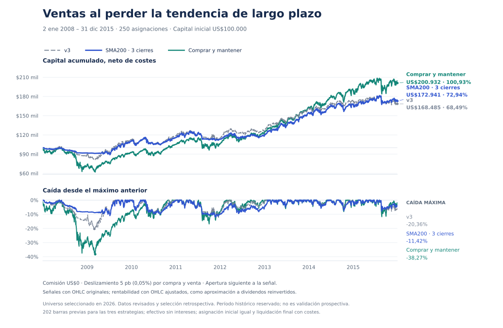

# Variante experimental: ventas al perder la tendencia de 200 sesiones

## Regla fijada antes de medir resultados

La variante conserva las señales de compra de v3 y vende únicamente después de **tres cierres confirmados consecutivos por debajo de la media simple de 200 cierres de cada fecha**. Ejecuta en la apertura de la sesión siguiente. Una igualdad o una sesión ausente interrumpe la secuencia; el promedio utiliza los últimos 200 cierres observados. La suma centrada evita una falsa ruptura por redondeo en precios constantes; no se introduce un margen ajustable.

No incluye salidas por SMA50, ATR, volumen, momentum ni emergencia. Si v3 marca venta y no se ha perdido la tendencia larga, pasa a Hold. Una venta larga prevalece sobre una compra coincidente; se cuentan esos conflictos. No se reconstruyen compras que v3 haya ocultado con su propia venta. Wait mantiene sus protecciones de datos. La liquidación al cierre final es una convención contable idéntica para los tres comparadores.

Es **una sola candidata experimental**, sin búsqueda de parámetros ni cambios posteriores para mejorar rentabilidad. Las evaluaciones anteriores de v1/v2/v3 forman parte del historial de investigación; no se presenta este ensayo como si fuera el primero. El [protocolo](../data/validation/long-trend-protocol.json) y el [registro de fuentes y entradas](../data/validation/long-trend-freeze.json) fijan reglas, períodos, costes y criterio de éxito. El scanner de producción conserva v3.

El registro se creó el **20/10/2026 a las 15:01:23 de Nueva York** (`2026-10-20T19:01:23.002Z`), con huella `1f07fbde52cc925faf5dcc108137162f236779f72a81f219e48ffe94a479a683`. El [commit de prerregistro](https://github.com/jpmauricio2906-bot/market-scanner/commit/84eac29cfc3ffea2ab7fe3af476a7e508b8bbd0a) precede a todas las simulaciones reales de esta variante. Las correcciones de redondeo y validación de caché se realizaron durante pruebas sintéticas previas a ese registro.

**Corrección técnica posterior a consultar resultados parciales:** la comprobación de calendario detuvo la comparación conocida de 2025–2026 porque su captura conserva ventanas de 500 barras con inicios distintos y algunas observaciones del 19/10, posteriores al final fijado del 16/10. Ya se había consultado el resultado de 2008–2015. Se conservaron el primer cálculo, el [protocolo original](../data/validation/long-trend-protocol-pre-calendar-fix.json) y el [registro original](../data/validation/long-trend-freeze-pre-calendar-fix.json). La corrección recorta datos posteriores al mismo corte y valida la cobertura inicial propia de SPY sólo en esa captura móvil, sin permitir huecos internos. La cobertura histórica de 2008–2015 y 2018–2023 conserva la comprobación estricta.

No cambiaron reglas, períodos, costes ni criterio de éxito. El [commit de corrección](https://github.com/jpmauricio2906-bot/market-scanner/commit/d4e727c4779681ba193271582ccb5baedfd448e1) y la huella `969d3757bd0eac2e439c5e1a4546fbd98d09cfce930a12cf1742ea886f0233f1` se registraron antes de repetir el cálculo. El registro corregido declara expresamente `beforeAnyExperimentReturns: false`; no se oculta la consulta previa.

Los libros completos son idénticos byte por byte antes y después de la corrección: 2008–2015 conserva SHA-256 `56cc456cddbf08f5b3f44984ed8d40b90af7037457a3a6af6b2e9e7fe869d4fa` y 2018–2023 conserva `0b8ee7102278d8ed01b929323c1c577d3b37e65f6624765dea93adb7da8daf12`.

## Separación de muestras y límites

La nueva muestra reservada abarca **02/01/2008–31/12/2015**, con 2006–2007 para preparar indicadores. Se descargó y controló su calidad antes de calcular retornos; las reglas y fuentes se registraron antes de ejecutar cualquier comparación real. También se muestran 2018–2023 y 2025–2026, **ya examinados**, exclusivamente como diagnósticos históricos.

Esta reserva no es una validación prospectiva ni cronológicamente independiente: los resultados de años posteriores motivaron la hipótesis. Además, el universo seleccionado en octubre de 2026 introduce selección retrospectiva y supervivencia; no incluye todas las empresas que desaparecieron. Los datos del proveedor pueden estar revisados. Una reserva histórica no elimina los riesgos de investigación secuencial y sobreajuste ([Bailey y colaboradores](https://www.davidhbailey.com/dhbpapers/backtest-prob.pdf)). Ningún resultado de este documento acredita por sí solo una ventaja futura. La validación prospectiva permanece pendiente.

## Datos y costes comunes

Hay 521.743 barras válidas de 2006–2015, 226 instrumentos con historia y 24 sin cotización anterior a 2016, verificados por la fecha de inicio del proveedor. No hubo descargas fallidas omitidas. Los 250 instrumentos mantienen su asignación inicial: lo no disponible queda en efectivo. Treinta instrumentos comienzan a cotizar durante 2008–2015. El calendario tiene 2.517 sesiones con calentamiento y 2.015 en la evaluación; coincide exactamente con SPY e incluye los cierres extraordinarios por Ford y Sandy. Las fuentes primarias se incluyen en el [calendario reproducible](../tools/long-trend-calendar.mjs).

Se excluyeron dos barras OHLC inválidas de SHEL, del 02/04/2007 y 23/05/2012, sin rellenarlas. Se corrigieron únicamente 785 envolventes OHLC ajustadas por redondeo numérico. Los precios originales no necesitaron esa corrección.

La señal utiliza OHLC originales, como v3 en producción. Los resultados principales de 2008–2015 y 2018–2023 usan OHLC ajustados por `adjclose/close`, como aproximación a dividendos reinvertidos. Son precios sintéticos, no cotizaciones históricas ejecutables literales. Se exige alineación exacta de fechas y símbolos. La sensibilidad sin dividendos conserva las mismas señales y usa cotizaciones originales también para valorar. La captura conocida de 2025–2026 sólo permite comparar precios, sin dividendos.

Capital inicial: $100.000 repartidos en 250 asignaciones de $400, fracciones de acciones, sin rebalanceo, intereses sobre efectivo, ventas cortas ni apalancamiento añadido. No se modelan impuestos, cargos regulatorios, spreads observados o capacidad de ejecución. Los ETF apalancados e inversos conservan sus riesgos incorporados.

Comisión del bróker **$0**; deslizamiento principal **0,05% por compra y por venta**, incluido el cierre final. Las sensibilidades fijadas son 0%, 0,10% y 0,25%. Para disponer de tres medias de 200 sesiones, las tres estrategias esperan **202 barras completas** antes de poder operar. Esto retrasa la entrada del benchmark en instrumentos recientes: es comprar y mantener con elegibilidad común. Se incluye también una sensibilidad de 50 barras, como la disponibilidad habitual de v3; en ella la variante podría comprar antes de disponer de su primera salida SMA200.

Los subperíodos fijos 2008–2011 y 2012–2015 reinician el efectivo. El criterio principal exige superar **tanto v3 como comprar y mantener** en rentabilidad acumulada neta a 5 puntos básicos por lado; se informa por separado si se mantiene a 10 puntos básicos y en ambos subperíodos. Una reducción de rotación o caída máxima no basta para superar ese criterio.

## Resultados de la muestra reservada: mejora parcial, criterio principal incumplido

**La variante no supera comprar y mantener en rentabilidad acumulada.** Gana 4,46 puntos porcentuales frente a v3 y reduce su caída máxima, pero queda 27,99 puntos por debajo del benchmark del mismo universo. Por tanto no cumple el criterio económico registrado de superar a ambos.

| 2008–2015, comisión $0 y deslizamiento 0,05% por lado | v3 | SMA200, tres cierres | Comprar y mantener |
| --- | ---: | ---: | ---: |
| Rentabilidad acumulada | 68,49% | 72,94% | 100,93% |
| Rentabilidad anualizada | 6,74% | 7,09% | 9,12% |
| Caída máxima | −20,36% | −11,42% | −38,27% |
| Sharpe, referencia efectivo 0% | 0,660 | 0,775 | 0,595 |
| Exposición media | 60,18% | 56,21% | 84,53% |
| Ciclos de compra y venta, incluido cierre final | 5.017 | 3.193 | 221 |
| Ventas por señal | 4.883 | 3.098 | 0 |
| Permanencia media, sesiones | 56,92 | 80,85 | 1.901,68 |
| Permanencia mediana, sesiones | 36 | 23 | 2.015 |
| Deslizamiento imputado, dólares | 2.522,85 | 1.482,45 | 138,89 |

Los 24 instrumentos no cotizados conservan $400 cada uno. Otros cinco no llegan a una apertura elegible bajo el requisito de 202 barras; por eso comprar y mantener realiza 221 ciclos. No se elimina su capital del denominador. Una operación cerrada es un ciclo completo, no una sola orden. Los costes se aplican en cada ejecución y alteran el capital disponible para operaciones futuras.



La duración **media** aumenta, pero la **mediana baja de 36 a 23 sesiones**. Por tanto, una media de 200 sesiones no hace que todas las posiciones duren más ni elimina todas las salidas cortas. La reducción de rotación y exposición también está influida por las compras de v3 que se bloquean durante una pérdida persistente de SMA200; no es una prueba aislada de retrasar exactamente las mismas ventas con idénticas entradas.

La revisión descriptiva de operaciones encuentra 654 ciclos de cinco sesiones o menos en la variante, frente a 561 en v3; representan 20,48% y 11,18% de sus ciclos, respectivamente. En cambio, los ciclos de más de 252 sesiones aumentan de 75 a 286. De los 654 ciclos cortos, 646 comenzaron con el cierre de señal en o por encima de SMA200: predominan cruces fallidos alrededor de la media. Entre 1.134 entradas con idéntico instrumento y fecha, la variante conserva 641 más tiempo, 326 menos y 167 igual. Estas comprobaciones se hicieron después de fijar las reglas y son explicaciones descriptivas, no nuevos criterios de éxito ni motivos para reajustar la candidata.

### Costes y subperíodos fijados

| Deslizamiento por cada lado, comisión $0 | v3 | SMA200 | Comprar y mantener |
| --- | ---: | ---: | ---: |
| 0,00% | 71,78% | 74,97% | 101,12% |
| 0,05%, principal | 68,49% | 72,94% | 100,93% |
| 0,10% | 65,26% | 70,94% | 100,74% |
| 0,25% | 56,01% | 65,11% | 100,18% |

| Escenario reservado, costes principales | v3 | SMA200 | Comprar y mantener |
| --- | ---: | ---: | ---: |
| 2008–2011, efectivo reiniciado | 14,37% | 13,09% | 5,47% |
| 2012–2015, efectivo reiniciado | 40,28% | 42,38% | 79,11% |
| Elegibilidad de 50 barras | 67,77% | 72,92% | 102,65% |
| Compra inicial forzada, luego reglas | 62,27% | 65,99% | 100,93% |
| Precios originales, sin dividendos | 54,34% | 60,33% | 77,27% |
| Sólo acciones | 75,99% | 81,07% | 109,66% |
| ETF sin apalancamiento | 44,57% | 38,73% | 56,67% |
| ETF apalancados/inversos | 14,06% | 47,26% | 103,42% |
| Sólo SPY | 87,67% | 51,67% | 64,51% |

La variante gana a mantener en 2008–2011, pero pierde frente a v3 en ese mismo tramo. En 2012–2015 gana a v3 y pierde frente a mantener. Tampoco mejora a v3 de forma universal: empeora en ETF sin apalancamiento y en SPY. No se elige el subperíodo ni el grupo favorable para declarar éxito.

### Períodos ya conocidos y elegibilidad

| Período y calentamiento común | v3 | SMA200 | Comprar y mantener |
| --- | ---: | ---: | ---: |
| 2018–2023, 202 barras, ajustados | 54,72% | 58,99% | 126,18% |
| 2018–2023, 50 barras, ajustados | 54,82% | 59,14% | 126,32% |
| 2025–2026, 202 barras, sin dividendos | 27,10% | 32,86% | 40,71% |
| 2025–2026, 50 barras, sin dividendos | 42,23% | 56,31% | 75,60% |

Estos períodos **no son fuera de muestra**. Los resultados con 50 barras reproducen exactamente v3 y el benchmark de los estudios anteriores. El requisito común de 202 explica que los resultados principales no coincidan con las cifras previamente publicadas. En la captura móvil de 2025–2026, además, retrasa las primeras compras hasta agosto de 2025; no representa una cartera invertida desde enero con historial largo completo. La sensibilidad de 50 permite entrar antes, pero entonces la variante todavía carece temporalmente de una salida SMA200 disponible.

La variante tampoco supera mantener en estos períodos. Su caída máxima en 2018–2023 es −16,29%, frente a −20,81% de v3 y −32,76% de mantener; en 2025–2026 empeora a **−10,91%**, frente a −8,39% de v3 y −9,78% de mantener. La reducción de riesgo observada en la muestra reservada no se reproduce universalmente.

### Incertidumbre y atribución

En 2008–2015, la variante supera a v3 en 110 de los 226 instrumentos con historia y a mantener en 81. El intervalo exploratorio del 95% de la diferencia media diaria es [−0,01262%; +0,01327%] frente a v3 y [−0,03645%; +0,01456%] frente a mantener. Ambos incluyen cero. Son intervalos de diferencias **diarias**, no de rentabilidad acumulada; usan 2.000 remuestreos en bloques de 20 sesiones y no corrigen los sesgos de selección.

Se registran 13.224 observaciones instrumento-fecha en las que una ruptura SMA200 prevalece sobre una compra de v3, y 26.343 en las que una venta de v3 se convierte en Hold. Son días de señal, no órdenes ejecutadas. En el análisis posterior de las órdenes, v3 realizó 2.449 compras con el cierre de señal bajo SMA200; la variante realizó 9. Esto ayuda a explicar que la variante tenga menor exposición y una distribución diferente de duraciones.

**Conclusión:** la variante obtiene una mejora agregada moderada frente a v3 y menor caída en 2008–2015, pero incumple el criterio de superar a ambos comparadores. No hay evidencia de una ventaja estadísticamente robusta ni de que elimine las salidas prematuras. Se publica como experimento, manteniendo v3 en producción y sin reajustar la regla tras examinar los resultados.

La revisión independiente reconcilió capital por instrumento, beneficios de operaciones, costes de ejecuciones y curvas. La valoración de SHEL en comprar y mantener arrastra una sesión por la barra ausente de 2012; v3 y la variante no tienen una posición abierta ese día. No hubo liquidaciones finales con cotizaciones desactualizadas. Los 259 tests del repositorio pasan.

## Reproducción y auditoría

El código conserva el scorer v3 SHA-256 `78e24a07358bf6c707b792fc6457f7f760014e3b5d75829bfd9ab119515d14fa`. Si ese archivo cambia, el ejecutor rechaza la comparación y exige utilizar el commit registrado. Las cachés se validan contra archivos de entrada, universo, ventanas, normalizador y generador de señales; no se reutilizan sólo por nombre.

Los datos nuevos tienen SHA-256 `e09f0bdac6611cec518f2573177509f6e40b1b42269c9bff22546d3ffa87e76f` (ajustados) y `4c418629be09ed92e4f07e4de50af78fade2faf6346cfa3e2195e5b26fd67184` (cotizaciones). La captura y respuestas originales están en `outputs/long-trend-validation/history-2006-2015`. Los resultados completos se conservan en `outputs/long-trend-validation/run-calendar-fixed`, incluyendo libros de operaciones, ejecuciones, escenarios, curvas y resultados por instrumento. El cálculo inicial incompleto permanece en `run`. Volver a descargar puede cambiar las series ajustadas y sus hashes.

Desde la raíz del código, con Node 22 o posterior:

```sh
node tools/fetch-validation-history.mjs --start 2006-01-01 --end-exclusive 2016-01-01 --output /ruta/captura
node tools/validate-long-trend.mjs --inputs /ruta/inputs.json --output /ruta/resultados --prepare-only
# Registrar el código y freeze.json antes de ejecutar:
node tools/validate-long-trend.mjs --inputs /ruta/inputs.json --output /ruta/resultados
node tools/export-long-trend.mjs --input /ruta/resultados/results.json --output data/validation
python tools/plot-long-trend.py --input /ruta/resultados/reserved_2008_2015/books.json --output /ruta/resultados/long-trend-equity.png
node --test tests/*.test.cjs tests/*.test.mjs
```

`inputs.json` es un arreglo con un elemento por cada `id` del protocolo. Cada elemento incluye `quote`, `adjusted` si corresponde y, opcionalmente, `v3Cache`, con rutas accesibles desde el directorio de ejecución. La configuración exacta usada se conserva junto a la captura local. Las entradas deben estar fuera del directorio de resultados. El modo `--prepare-only` registra hashes sin calcular rendimientos; la ejecución posterior falla si cambia cualquier fuente o entrada congelada.

Se publican el [resultado completo de métricas y escenarios](../data/validation/long-trend-results.json), las [curvas compactas](../data/validation/long-trend-equity.csv) y la [comparación por instrumento](../data/validation/long-trend-per-ticker.csv). Retornos y caídas sin sufijo `Pct` son fracciones, no porcentajes; capital y costes son dólares. Los gráficos requieren matplotlib; el backtest y las pruebas usan únicamente Node. El exportador no recalcula resultados y comprueba que las métricas coincidan con los libros. El JSON publicado conserva los mismos bytes y SHA-256 `59669a839f6f906a19ed962c0fc0e452d242d54809d96b3162f30c1e91c290d2` del resultado local corregido.
